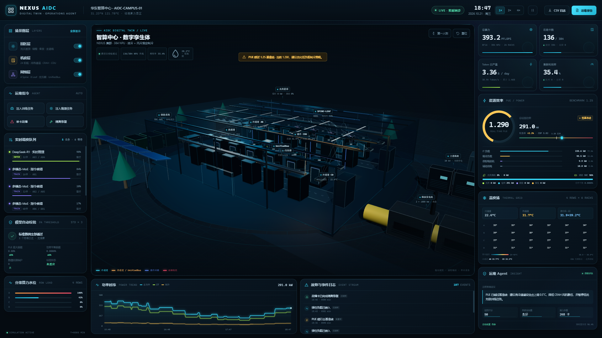

# NEXUS AIDC · AI 智算中心数字孪生仿真与运维 Agent

面向 AI 智算中心（AIDC）的完整 npm 工程：Three.js 三维数字孪生、NPU 算力调度、能耗 / 热场仿真、自动模型校验、实时数据看板和运维报告生成。



## 快速开始

```bash
npm install
npm run dev
```

浏览器打开终端输出的地址（默认 `http://localhost:5173/`）。`npm run dev` 会启动 Vite 开发服务器并直接提供看板。

其他脚本：

```bash
npm test          # Vitest 单元测试（18 项）
npm run build     # TypeScript 类型检查 + 生产构建
npm run simulate  # 无头仿真 12 小时，生成 CSV / Markdown / JSON 产物
npm run preview   # 预览生产构建
```

运行环境：Node.js ≥ 22.12（推荐 Node 24），支持 WebGL2 的现代浏览器。

## 功能地图

| 模块 | 实现 |
| --- | --- |
| 园区层 | 光伏屋顶阵列、1.2 MWh 储能、2 × 1000 kW 柴发、主进线柜、变压器、干冷器 |
| 机房层 | 4 排 × 6 柜，共 24 柜 / 384 张 NPU；封闭冷通道、热通道、4 台行级空调、2 台液冷 CDU、智能母线槽 |
| 网络层 | 4 台 Spine、8 台 Leaf、光模块链路、跨柜 UnifiedBus；动态数据流粒子 |
| 交互 | 轨道旋转 / 缩放、第一人称 WASD 漫游、设备点击弹窗、设备定位、图层独立显隐 |
| 故障可视化 | 机柜红色高亮、脉冲地环、红色光柱、`● FAULT` 悬浮标记、热力图红框 |
| 算力调度 | 训练 / 推理任务自动放置、队列、利用率、Token 吞吐、单卡故障热迁移、断点续跑、故障隔离恢复 |
| 能耗仿真 | IT / 制冷 / 供配电损耗 / 辅助四分项、COP 与环境温度联动、光伏 / 储能 / 电网 / 柴发功率平衡、PUE 与基准线 |
| 热场仿真 | 冷热通道一阶热惯性、24 柜排风热力图、液冷供回液与负载联动、边界钳制与发散回滚 |
| 数据看板 | 总算力、在跑卡数、Token 日产量、利用率、总功耗、PUE、制冷占比、可再生占比、温度热力图、功率时序、事件日志 |
| 自动校验 | 3 个标准工况，PUE 与功率平衡双校验；偏差 > 5% 自动校正制冷标定并复验 |
| 输出 | 页面实时导出 CSV / Markdown；`npm run simulate` 预生成 `reports/` 全套产物 |

## 架构

```text
.
├── index.html
├── src/
│   ├── main.ts                    # 启动、错误兜底、应用实例
│   ├── types.ts                   # 全链路领域类型
│   ├── data/topology.ts           # 园区 / 机柜 / 网络 / 任务模板常量
│   ├── sim/
│   │   ├── math.ts                # 钳制、有限值保护、确定性 RNG
│   │   ├── scheduler.ts           # 卡级调度、队列、故障注入、热迁移
│   │   ├── energy.ts              # 能耗、光伏储能、PUE、热场模型
│   │   ├── validator.ts           # 标准工况自校验与自动修正
│   │   └── engine.ts              # 仿真编排、遥测、告警、发散回滚
│   ├── scene/
│   │   └── DigitalTwinScene.ts    # Three.js 场景、图层、交互、WebGL 动画
│   ├── ui/
│   │   ├── dashboard.ts           # 看板布局、状态渲染、控制与导出
│   │   ├── charts.ts              # Canvas 功率时序曲线
│   │   └── deviceInfo.ts          # 设备弹窗数据映射
│   ├── logging/
│   │   ├── csv.ts                 # CSV 序列化与浏览器下载
│   │   └── report.ts              # Markdown 运维分析报告
│   └── styles.css                 # 深色工业级数据看板视觉
├── scripts/
│   ├── simulate.ts                # 12h 无头仿真与产物生成
│   └── browser-check.mjs          # 可选：CDP 浏览器交互 / 报错检查
├── tests/                         # 能耗、调度、校验、引擎单元测试
└── reports/                       # 预生成运行日志、事件、报告与截图
```

## 仿真口径

### 算力

- 集群：24 柜 × 16 NPU = **384 卡**，单卡 BF16 峰值 1024 TFLOPS，总算力 **393.2 PFLOPS**。
- 初始种子负载 288 卡：3 个训练任务 + 3 个推理任务，保留 96 卡迁移余量。
- 调度：训练任务优先分散放置，推理任务优先连续低时延放置；资源不足进入队列。
- 故障：随机选择在跑单卡 → 置为不健康 → 任务断点冻结 → 从健康空闲池补卡 → 3 个调度周期后恢复满速；无可用补卡时任务安全回队并释放占用。
- Token 吞吐 = Σ(运行中任务卡数 × 单卡 Token/s)；日产量按实时吞吐投影到 24 小时。

### 能耗与 PUE

```text
总功耗 = IT + 制冷 + 供配电损耗 + 辅助
PUE    = 总功耗 / IT

制冷   = 风冷热量 / COP + 风冷风扇 + 液冷热量 × 系数 + CDU 泵 + 固定冷量
配电   = IT × 4% + 制冷 × 2%
COP    = f(室外温度, 部分负载率)，钳制在 2.8–6.8
```

- 光伏优先直供，富余给储能充电，余量上网；储能 SOC 12%–96%，必要时削峰放电；柴发仅容量不足时投入。
- 功率守恒：`电网 + 光伏 + 电池放电 + 柴发 = 总负荷 + 电池充电 + 上网`，标准工况偏差 < 0.001%。
- 基准线 **1.25**；超过时 PUE 环变黄、顶部黄色告警条出现。
- 12 小时仿真末端低负载（约 31%）PUE 升至 **1.295**，自动触发告警与优化建议。

### 热场

- 冷通道目标温度随风冷负载、室外温度动态变化；热通道随 B/C 排回风负载变化。
- 液冷供液温度随环境温度变化，回液温度 = 供液 + 基础温升 + 液冷负载换热温升。
- 一阶惯性时间常数 150–240 s，硬边界 17–68°C；另设非有限值 / 超范围检测与回滚。

## 自动校验

标准算例位于 `src/sim/validator.ts`：

| 算例 | 工况 |
| --- | --- |
| STD-01 | IT 500 kW，风冷 / 液冷各 50%，25°C，无光伏 |
| STD-02 | IT 400 kW，35°C 高温，光伏 180 kW |
| STD-03 | IT 220 kW，24°C 夜间低负载 |

每例均与不可变默认系数构建的 canonical 参考模型比对 PUE 和功率守恒。PUE 偏差 > 5% 时，以有界反馈环修正制冷标定系数并重新校验；功率平衡偏差 > 5% 时重同步计量通道。单元测试会主动注入 0.35 / 1.6 的制冷偏差，验证自动修正后偏差回到 5% 以内。

## 浏览器操作

- **轨道模式**：左键拖动旋转，滚轮缩放，右键平移。
- **第一人称**：点击「第一人称」或按提示进入；`W A S D` 移动，鼠标拖拽转向，`Shift` 加速，`Esc` 退出。
- **设备**：点击任意设备查看实时指标；「定位设备」可聚焦相机。
- **图层**：左侧「园区层 / 机房层 / 网络层」独立开关。
- **运维指令**：注入训练 / 推理任务、单卡故障、隔离修复、暂停 / 速度调节。
- **导出**：右上角下载实时 CSV 日志与 Markdown 运维报告。

## 预生成产物

| 文件 | 内容 |
| --- | --- |
| [`reports/runtime-log.csv`](reports/runtime-log.csv) | 720 个逐分钟遥测采样点，22 个字段 |
| [`reports/fault-events.csv`](reports/fault-events.csv) | 完整事件链（故障、迁移、调度、能耗、校验） |
| [`reports/ops-report.md`](reports/ops-report.md) | 12 小时运维分析报告（含校验、热场、建议） |
| [`reports/validation-report.json`](reports/validation-report.json) | 标准工况校验结构 |
| [`reports/run-summary.json`](reports/run-summary.json) | 运行摘要 |
| [`reports/dashboard-final.png`](reports/dashboard-final.png) | 看板截图（低负载 PUE 黄色告警） |
| [`reports/dashboard-fault.png`](reports/dashboard-fault.png) | 单卡故障红色高亮 / 热迁移截图 |

## 可靠性设计

- 能耗 / 热场所有输入输出均使用 `Number.isFinite`、上下界钳制和回退值。
- 引擎每 tick 检查 PUE、功率、温度场；异常时回滚上一有效帧、重置标定并记录事件。
- 3D 动画采用 try/catch 隔离数据流粒子异常，单条链路故障不会中断渲染循环。
- 使用 Three.js 新版 `Timer` 与 `PCFShadowMap`，消除弃用告警。
- E2E 浏览器检查（CDP）覆盖：WebGL 初始化、设备点击弹窗、故障注入、热迁移、队列、第一人称、PUE 告警与布局溢出。
